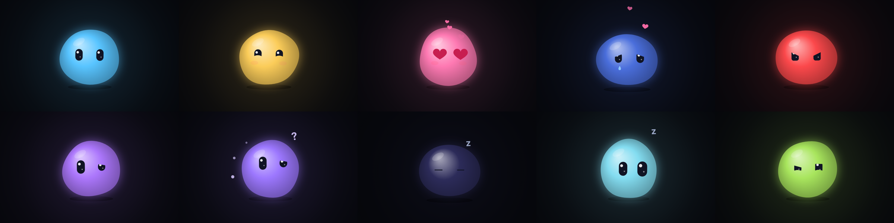

# Walter the Wall Buddy

**Status:** invite-only beta. A product of [Qiiver LLC](https://wallter.app).

Walter is a voice assistant that lives on your wall: a spare laptop plugged into a
monitor, showing nothing but a glowing blob with two big eyes. You talk to him and he
talks back. He has no mouth; he shows how he feels with his eyes, his colour and his
body (bouncing, squishing, wobbling, drooping).



His brain is [Claude Code](https://docs.anthropic.com/en/docs/claude-code) running
headless with **your own** Claude account or API key, so he isn't just a chatbot: he can
use the web, files and a shell, hand long jobs to background workers while he keeps
talking with you, run routines (a morning briefing, reminders), keep a family list and
calendar on the wall, and even improve his own code.

```
 mic ─► VAD ─► Whisper (local) ─► "Walter, …?" ─► Claude Code (headless)
                                                     │ streamed reply with [emotion] tags
 speakers ◄─ Piper TTS (local) ◄─ sentences ◄────────┤
 screen   ◄─ face (Chromium kiosk, canvas) ◄─ emotions / actions / loudness (websocket)
```

## Quick start

- **Beta households:** follow [docs/QUICKSTART.md](docs/QUICKSTART.md) (10 steps). The
  installer and signed updates come from **https://releases.wallter.app**:
  `curl -fsSL https://releases.wallter.app/install.sh | sudo bash -s -- --invite YOUR-CODE`.
  Full details: [docs/BETA-INSTALL.md](docs/BETA-INSTALL.md).
- **Hardware:** any 64-bit laptop from about 2015 on with 4 GB+ RAM (8 GB is nicer),
  Debian 12 or 13, a monitor, and ideally a USB speakerphone ("puck") so he hears you
  across the room. Portrait screens work too.
- **Just trying the code** on any computer (no install, no wall):
  ```bash
  python3 -m venv .venv && .venv/bin/pip install -r requirements.txt
  .venv/bin/python -m walter            # then open http://127.0.0.1:8765
  ```
  Without speakers Walter "mimes" his speech; `--no-ears` skips the microphone.

Using Walter day to day: [docs/USER-MANUAL.md](docs/USER-MANUAL.md). Problems:
[docs/TROUBLESHOOTING.md](docs/TROUBLESHOOTING.md).

## Privacy: what stays home and what doesn't

- **Ears and voice are local.** The microphone, wake word, speech recognition (Whisper)
  and the voice (Piper) all run on the laptop. No audio is recorded or uploaded.
- **What goes to Claude:** the text of what you say to Walter (after his name, or in the
  short follow-up window), what you type to him, and whatever he reads to do the job
  (web pages, and your calendar or email only if you connect them). That goes to
  Anthropic under your own Claude account or API key; Walter never sees your Claude
  password.
- **Optional cloud speech** (OpenAI voice or transcription) is off by default, capped,
  and shown by a small cloud mark on the face when on.
- **Camera and recognition** are off unless you turn them on. Face and voice recognition
  store embeddings only (never photos or recordings), locally, and only for people who
  said yes.
- **Your notes live on your laptop** in `~/.walter` (his memory, your list, settings,
  secrets in mode-600 files). Nothing goes to Qiiver unless you send feedback or a
  (redacted, previewable) diagnostics bundle yourself. The optional Cloud Link reaches
  the companion app from outside your home through a Cloudflare tunnel; only the app's
  paths are exposed, and pairing is still required.

## Companion app, faces and more

- **Companion app** (`app/`): a phone/computer web app for chat, push-to-talk, the list,
  the calendar and notifications. Pair it with a 6-digit code shown on the wall.
- **Faces** ([docs/FACES.md](docs/FACES.md)): one Walter brain, many screens (kitchen
  tablet, office laptop). [docs/DESKTOP.md](docs/DESKTOP.md) and
  [docs/HANDS.md](docs/HANDS.md) cover the desktop face and opt-in computer use.
- **Workspaces, cluster, Home Assistant, music:** see [docs/](docs/).

## Safety model

Walter is an AI agent with a shell, files and the network, and he reads text written by
strangers (web pages, email, calendar invites). The full threat model is in
[docs/SECURITY.md](docs/SECURITY.md). In short:

- Fresh installs run Claude Code in `acceptEdits` mode with allow and deny lists, not
  "do anything" mode. Full admin rights (passwordless sudo) are opt-in and off by default.
- Text from outside is wrapped as untrusted data, never instructions. Sending email,
  buying, unlocking or anything irreversible needs your spoken yes.
- The HTTP API listens on `127.0.0.1`; the phone pages and the app are gated and paired.
- Devices only install updates signed by Qiiver's release key.
- Give Walter a dedicated laptop and user account; don't keep other secrets on it.

`walterctl security status` checks a running install.

## What's in here

| Path | What |
|---|---|
| `walter/` | The Python service: brain (persistent Claude Code), workers, ears, voice, conductor, servers. |
| `face/` | The face: one HTML page and a canvas animation (emotions, body actions, dashboard, panels). |
| `app/` | The companion web app (PWA). |
| `bin/walterctl` | Command-line control panel; Walter uses it himself. |
| `home/` | Template for Walter's working folder (`~/.walter/home`): personality `CLAUDE.md`, blank `memory.md`, skills. |
| `deploy/` | `install.sh`, systemd units, kiosk launcher, updater, `rescue.sh`. |
| `iso/` | The one-file USB installer build and a VM test. |
| `desktop/` | The desktop face (laptop client). |
| `tests/` | pytest and node tests; `tests/fake_claude.py` stands in for Claude Code. |

## Development

```bash
.venv/bin/pip install pytest && .venv/bin/python -m pytest -q
```

To run the whole stack without using a Claude account, set
`claude_bin = "/path/to/tests/fake_claude.py"` in a config file. You can also open
`face/index.html` in a browser and drive the face from the keyboard (`1`–`0` emotions).

## Contributing

Issues and pull requests are welcome; a maintainer at Qiiver reviews every change, and
merging does not ship anything to anyone's home until a signed release is cut. Please
read [CONTRIBUTING.md](CONTRIBUTING.md) and our [Code of Conduct](CODE_OF_CONDUCT.md).
Found a security problem? Please don't open an issue: see [SECURITY.md](SECURITY.md).

## License

Walter is licensed under the [Apache License 2.0](LICENSE), copyright 2026 Qiiver LLC.
Third-party components and their licences are listed in [NOTICE](NOTICE). "Walter" and
the Walter face are marks of Qiiver LLC; the licence doesn't grant rights to use them.
